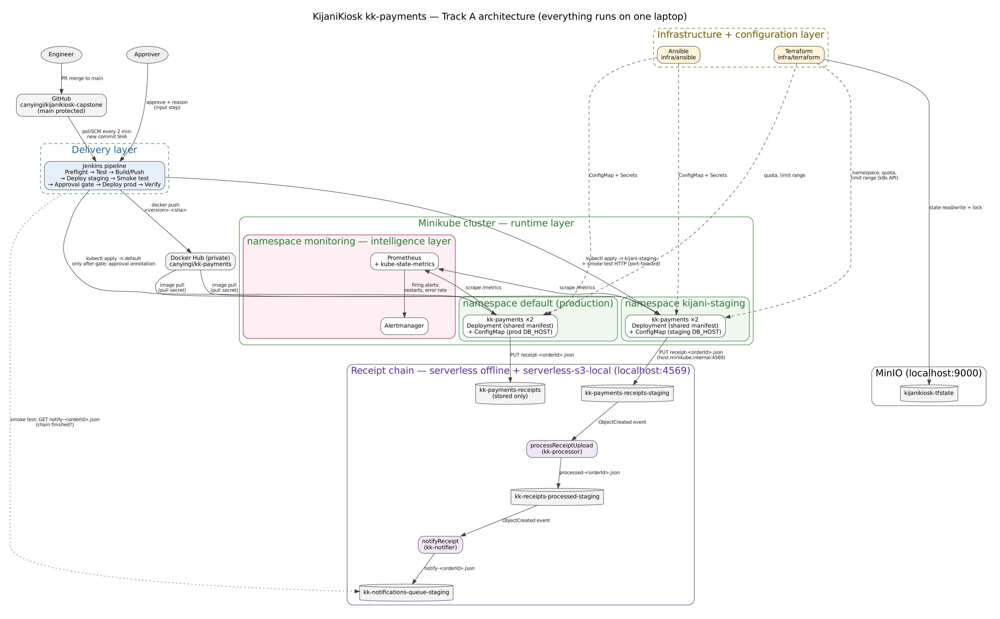

# KijaniKiosk kk-payments: delivery platform (Capstone, Track A)

My DevOps capstone. It takes the kk-payments service I built during the course and gives it a proper path to production: a staging environment, a pipeline that tests every change there first, a recorded human approval before production, alerts, and the receipt chain from Week 10.

> **Status:** v1.0.0 (capstone submission). Everything runs on one laptop: Minikube, Jenkins, MinIO and the serverless receipt chain.
> It is *close to* production, not production. The gaps I know about are in [section 7](#7-known-gaps-and-how-to-contribute).

<!-- ASSUMPTION: I have used seven sections. Check the names against the capstone guide (CAP-3) before submitting. -->

## 1. What this is and why I built it

Until Week 8, every kk-payments change I made went straight into the only namespace I had (`default`). There was no place to test a release first, no record of who approved it or why, and nothing told me when pods kept crashing. This repo fixes that:

- a **staging namespace** (`kijani-staging`) that runs the **same Deployment file** as production, with its own settings
- a **Jenkins pipeline**: every merge to `main` is deployed to staging and smoke-tested, and only then does it ask a person to approve production, recording **who** approved it and **why**
- **alerts** when kk-payments pods keep restarting or payments start failing
- the **receipt chain**: a payment in staging writes a receipt that triggers kk-processor and then kk-notifier

## 2. Architecture



| Layer | What it owns | Tool | Folder |
|---|---|---|---|
| Infrastructure | Namespaces, quotas, limit ranges | Terraform (state in MinIO) | `infra/terraform/` |
| Configuration | ConfigMaps and Secrets for each environment | Ansible | `infra/ansible/` |
| Delivery | Test, build, push, deploy, smoke test, approval | Jenkins | `Jenkinsfile`, `scripts/` |
| Runtime | kk-payments Deployment and Service (one file, two namespaces) | Kubernetes (Minikube) | `k8s/`, `app/` |
| Intelligence | Alert rules and metrics | Prometheus + Alertmanager | `monitoring/` |
| Receipt chain | Three functions triggered by bucket events | Serverless Framework v3 (offline) | `serverless/` |

Why I drew the lines between layers where I did is written up in `docs/decisions/` (ADR-001 to ADR-004).
How I used AI on this project, what it got wrong, and a review of the system against the Week 10 six-point governance checklist: `docs/ai-governance-log.md`.
Screenshots proving each success criterion: `docs/evidence/`.

## 3. What you need

I built and tested this on Ubuntu (HP EliteBook 840 G5, **7 GB RAM**). Run `make check`: it lists anything missing.

> **Memory matters.** Minikube (3 GB VM) + Jenkins + Prometheus + the receipt chain need most of a 7–8 GB laptop. When I first added the full Prometheus stack, the laptop ran out of memory and VirtualBox killed the Minikube VM. Before starting: close spare browser tabs, stop other VMs (`multipass suspend --all`), and keep Jenkins capped at 768 MB (4.7). Check with `free -h`: aim for 1 GB+ available once everything is running.

| Tool | Version I used | Notes |
|---|---|---|
| Minikube | 1.39 | **VirtualBox driver**, 3 GB / 2 CPU (Minikube runs as a VM at `192.168.59.103`) |
| kubectl | 1.37 | Install the binary in `/usr/local/bin` too: Jenkins can't see the snap version in `/snap/bin` |
| Docker | 29.x (snap) | The pipeline avoids volume mounts because snap Docker can't see `/var/lib/jenkins` |
| Terraform | 1.16 | |
| Ansible | core 2.21 | plus `ansible-galaxy collection install kubernetes.core` and `sudo apt install python3-kubernetes` |
| Helm | 3.22 | for Prometheus |
| Node | 20 (nvm) | only needed for running things by hand; the pipeline runs Node in a container |
| jq | any | |
| Jenkins LTS | installed with apt, not in Docker | the apt repo needs the **2026** signing key |
| Docker Hub | a **private** `kk-payments` repo and an access token | |

## 4. Setup: from a fresh clone to a working system

Each step says how to check it worked. If it didn't, see [section 6](#6-troubleshooting).

**4.1 Clone and add your secrets**
```bash
git clone https://github.com/canyingi/kijanikiosk-capstone.git && cd kijanikiosk-capstone
cp .env.example .env          # fill in every value; .env is git-ignored
set -a; source .env; set +a
echo "user=${#AWS_ACCESS_KEY_ID} secret=${#AWS_SECRET_ACCESS_KEY}"   # neither may be 0
```
I learned the length check the hard way: my first MinIO started with empty values and silently used the default `minioadmin` login.

**4.2 Start MinIO (Terraform state) and Minikube**
```bash
docker run -d --name kk-minio --restart unless-stopped -p 9000:9000 -p 9001:9001 \
  -e MINIO_ROOT_USER="$AWS_ACCESS_KEY_ID" -e MINIO_ROOT_PASSWORD="$AWS_SECRET_ACCESS_KEY" \
  -v ~/capstone/minio-data:/data pgsty/minio server /data --console-address ":9001"
docker exec kk-minio mcli alias set local http://127.0.0.1:9000 "$AWS_ACCESS_KEY_ID" "$AWS_SECRET_ACCESS_KEY"
docker exec kk-minio mcli mb local/kijanikiosk-tfstate
minikube start --driver=virtualbox
```
✅ `kubectl get nodes` shows `Ready`.

**4.3 Let Minikube pods reach the receipt chain on the laptop**

If your laptop runs `ufw` (mine does, from Week 3), pods can't reach port 4569 on the host. Open only that port, only from the Minikube network:
```bash
sudo ufw allow in on vboxnet0 from 192.168.59.0/24 to any port 4569 proto tcp comment 'Minikube pods -> receipt chain'
```

**4.4 Infrastructure (Terraform)**
```bash
make infra
```
✅ `kubectl get ns kijani-staging` exists, and a second `terraform plan` says **No changes**.

**4.5 Configuration (Ansible)**
```bash
make config
```
✅ `kubectl -n kijani-staging get cm kk-payments-config -o jsonpath='{.data.DB_HOST}'` shows the staging host. A second run reports `changed=0`.

**4.6 Receipt chain (leave this terminal open)**
```bash
make chain
```
✅ `S3 local started ( port:4569 ... address: 0.0.0.0 )` and `Server ready: http://0.0.0.0:3005`.

**4.7 Jenkins**
1. Install Jenkins LTS with apt (use the 2026 key from jenkins.io), then `sudo usermod -aG docker jenkins`. Cap its memory:
   ```bash
   sudo mkdir -p /etc/systemd/system/jenkins.service.d
   printf '[Service]\nEnvironment="JAVA_OPTS=-Djava.awt.headless=true -Xmx768m"\n' | sudo tee /etc/systemd/system/jenkins.service.d/memory.conf
   ```
2. Give Jenkins its own copy of the cluster login:
   ```bash
   kubectl config view --flatten --minify > /tmp/jk && sudo install -o jenkins -g jenkins -m 600 /tmp/jk /var/lib/jenkins/.kube/config && rm /tmp/jk
   sudo systemctl restart jenkins
   ```
3. In Jenkins: add credential `dockerhub-creds` (Docker Hub username + token), then create a Pipeline job `kijanikiosk-capstone` → *Pipeline script from SCM* → this repo, branch `*/main`, script `Jenkinsfile`.
   Only the Jenkins user named in `submitter:` in the *Approve Production* stage can release to production (currently `canyingi`). Change it to your own Jenkins user ID.
4. Click **Build Now** once. That run registers the 2-minute polling trigger; from then on every merge to `main` builds by itself.

✅ The build reaches **Approve Production**.

**4.8 Monitoring**
```bash
make monitoring
```
✅ http://192.168.59.103:30090/alerts lists both `KkPayments*` rules (Prometheus), and http://192.168.59.103:30093 is Alertmanager.
The monitoring stack is cut down to fit the laptop (no Grafana, no default rules, no node-exporter); see the comments in `monitoring/values.yaml`. Prometheus and Alertmanager use NodePorts because `kubectl port-forward` kept timing out when the VM was busy.

### Every time the laptop restarts
```bash
minikube start
kubectl config view --flatten --minify > /tmp/jk && sudo install -o jenkins -g jenkins -m 600 /tmp/jk /var/lib/jenkins/.kube/config && rm /tmp/jk
make chain        # in its own terminal
make check
```
MinIO and Jenkins start by themselves.

## 5. Day-to-day use

| I want to… | Do this |
|---|---|
| Ship a change | Branch `feat/...` → PR to `main` → *Rebase and merge*. Jenkins deploys staging within about 2 minutes. |
| Release to production | Open `http://localhost:8080/job/kijanikiosk-capstone/lastBuild/input/` → click **inside the REASON box** and type a reason of at least 10 characters → **Promote to production**. Only the `submitter` user can approve |
| See who approved a release, and why | `kubectl get deploy kk-payments -o jsonpath='{.metadata.annotations}'`, or the build's `approval-record.json` |
| Roll back | `kubectl -n <namespace> rollout undo deployment/kk-payments` |
| Rehearse a crash | `scripts/inject-fault.sh kijani-staging crash`. Old pods keep serving (`minReadySeconds: 15`), and `KkPaymentsPodRestarting` fires in a few minutes. Undo with `none` |
| Rehearse an error-rate incident | `scripts/inject-fault.sh kijani-staging error`, then send about 1 payment a second for 4 minutes (port-forward + a `curl` loop). `KkPaymentsHighErrorRate` fires after 2 minutes above 5%. Undo with `none` |
| Test the receipt chain on its own | `curl -X POST localhost:3005/staging/receipts -H 'Content-Type: application/json' -d '{"orderId":"ORD-1","amount":100}'` |

Branch, commit and PR rules: [CONTRIBUTING.md](CONTRIBUTING.md). Alert response steps: [docs/runbook.md](docs/runbook.md).

## 6. Troubleshooting

Every row here is something that actually happened to me while building this.

| What you see | Why | Fix |
|---|---|---|
| Terraform: `InvalidAccessKeyId` | `.env` values were empty when MinIO started, so MinIO is on its default login | Fill `.env`, check the lengths are not 0, recreate the `kk-minio` container |
| apt: `NO_PUBKEY 7198F4B714ABFC68` for Jenkins | Jenkins changed its signing key in 2026 | Use `jenkins.io-2026.key` |
| Pipeline: `kubectl: not found` | Jenkins's PATH has no `/snap/bin` | Install the kubectl binary in `/usr/local/bin` |
| Pipeline: `mkdir /var/lib/jenkins: read-only file system` | snap Docker can't mount the Jenkins workspace | Already handled: the tests stream the code in with `tar` |
| Pipeline stuck in Preflight with `i/o timeout` to `192.168.59.103:8443` | Minikube stopped (laptop slept) | `minikube start`, then refresh the Jenkins kubeconfig |
| Pod: `POST /payments` 500, log says `The specified bucket does not exist` | The local S3 server read `host.minikube.internal` as a bucket name | `vhostBuckets: false` in `serverless.yml` (already set) |
| Pod can't reach port 4569 (timeout) | `ufw` blocks it | The rule in 4.3 |
| `EADDRINUSE :3000` or `:3001` when running things by hand | My Week 8 blue/green services use those ports | Use another port locally (I use 3101); the chain uses 3005 |
| `ImagePullBackOff` | Pull secret or tag wrong | `kubectl describe pod`, then re-run `make config` |
| Minikube VM `aborted`, `no route to host` | The laptop ran out of memory (it happened when I installed the full Prometheus stack) | Free memory (see §3), `minikube start`, keep `monitoring/values.yaml` slim |
| `kubectl port-forward ... Error creating error stream: Timeout` | The VM is too busy | Use the NodePorts (30090 / 30093) instead |
| Approval refused: `a reason of at least 10 characters is required` | The REASON box was empty: approving from the console pop-up doesn't send it | Use the `/input/` page and click inside the box before typing |
| A crashing release takes all pods down | Pods pass readiness before they crash | Fixed with `minReadySeconds: 15` in the Deployment (keep it) |

## 7. Known gaps and how to contribute

These are deliberate limits of a one-laptop project, not things I forgot.

| Gap | Risk | What fixing it would look like |
|---|---|---|
| One Minikube node runs both staging and production | Staging load affects production; one failure takes down both | Separate clusters, or node pools with taints |
| Jenkins uses the Minikube **admin** kubeconfig (governance C1) | Jenkins could change any namespace | A `jenkins-deployer` ServiceAccount with a namespaced Role, only in `kijani-staging` and `default` |
| Receipts travel over plain HTTP, buckets unencrypted (C2) | Payment data readable in transit and at rest | In AWS: bucket encryption (`aws:kms`) and HTTPS; locally accepted (host-only network) |
| `region: us-east-1` in `serverless.yml` (C6) | East African payment data would be stored in the USA | `af-south-1`, and a check against Kenya's Data Protection Act before any real deployment |
| Jenkins keeps only 20 builds (C5) | Older approval records disappear | Copy `approval-record.json` to a bucket on every release |
| No NetworkPolicy | A staging pod can call production Services | Default-deny NetworkPolicy per namespace (needs a CNI such as Calico) |
| Secrets are plain Kubernetes Secrets | Anyone who can read the namespace can decode them | External Secrets Operator with Vault or SOPS |
| Polling instead of webhooks | Up to 2 min delay, and nothing builds while the laptop sleeps | Jenkins behind an authenticated ingress with a GitHub webhook |
| Alerts only show in Alertmanager | Nobody gets paged | An Alertmanager receiver for email or Slack |
| Restart alert can flap during a long crash loop | CrashLoopBackOff waits up to 5 min between restarts, so about 2 per 10 min, right on the threshold | Also alert on `kube_pod_container_status_waiting_reason{reason="CrashLoopBackOff"}` |
| A rejected approval also rolls staging back | Staging stops matching `main` | Treat "not approved" differently from "broken" |
| Production receipts are stored but not processed | Only staging runs the receipt chain | Deploy the chain for production too (`--stage production`) |
| A crashed function loses its event | No retry | A dead-letter queue (SQS) in real AWS |
| Two Docker installs (snap daemon, apt CLI) | Confusing for a new engineer | Standardise on one |
| AWS SDK will need Node 22 after January 2027 | Future SDK updates stop | Move the images to Node 22 |

New here? Read `docs/decisions/` before changing where one layer ends and another begins. Then pick an open Issue.
